<p align="center">
  
</p>

<h3 align="center">Discover, track, and never miss a government or private job opportunity.</h3>

<p align="center">
  A production-grade job discovery platform for India's government and private sector —
  jobs, results, admit cards, answer keys, syllabi, admissions, and preparation resources in one place.
</p>

<p align="center">
  <a href="https://www.chayanjobs.com"><strong>🌐 Live Site</strong></a> ·
  <a href="#-features"><strong>Features</strong></a> ·
  <a href="#-tech-stack"><strong>Tech Stack</strong></a> ·
  <a href="#-getting-started"><strong>Getting Started</strong></a> ·
  <a href="#-contributing"><strong>Contributing</strong></a>
</p>

<p align="center">
  <a href="https://github.com/qyronx558/Chayan/actions/workflows/database-migrate.yml">
    
  </a>
  
  
  
  
  
</p>

---

## 📖 Overview

**ChayanJobs** aggregates official government and private job notifications, exam results, admit cards, answer keys, syllabi, and admission updates from sources across India. Instead of monitoring dozens of websites every day, aspirants get one fast, searchable, and personalised platform.

The project is built with a strong focus on **SEO**, **performance**, **accessibility**, and **monetisation**, and is designed for serverless deployment on Vercel with PostgreSQL and Prisma.

> **Live application:** [www.chayanjobs.com](https://www.chayanjobs.com)

---

## ✨ Features

### For Job Seekers

- **Unified search** — government jobs, private jobs, results, admit cards, answer keys, syllabi, admissions, and blogs in a single search experience.
- **Personalised alerts** — notifications for new opportunities matching qualifications, location, and category preferences.
- **Application tracker** — a Kanban-style pipeline: `Interested → Applied → Admit Card → Exam Done → Result`.
- **Exam calendar** — month view with exam, admit card, and result dates, plus upcoming deadline teasers.
- **Qualification-based discovery** — 32 qualification chips (10th, 12th, B.Tech, B.Sc, MBBS, MBA, Nursing, and more) with token-level matching.
- **Bookmarks, history, and resume upload** — save opportunities, revisit viewed items, and receive better recommendations.
- **Dark / light mode** — system-aware with a manual toggle.
- **PWA ready** — installable and offline-capable via a service worker.
- **Fully responsive** — mobile-first design across all screen sizes.

### Content Coverage

| Section | Description |
| --- | --- |
| **Government Jobs** | Central (UPSC, SSC, Banking, Railway, Defence) and State PSCs |
| **Private Jobs** | Company-wise listings with direct application links |
| **Results** | Merit lists, cut-offs, and scorecards with PDF links |
| **Admit Cards** | Hall tickets with exam centres, timings, and download links |
| **Answer Keys** | Official keys with objection-window tracking |
| **Syllabi** | Subject-wise breakdowns with downloadable PDFs |
| **Admissions** | University and college admissions with dates, fees, and process |
| **Blogs & Notifications** | Preparation guides, exam analysis, and policy updates |

### Platform Capabilities

- **SSR + ISR** with the Next.js App Router for strong SEO and fast page loads.
- **Real-time notifications** via SSE streaming and an in-app bell with unread counts.
- **Authentication** with NextAuth v5 (Auth.js) using credentials and Google OAuth.
- **Admin dashboard** with relation pickers, moderation, audit trails, and bulk workflows.
- **Durable contact delivery** with retry queues and cron-triggered workers.
- **Analytics and monetisation** with GA4, Google Search Console, and AdSense.

---

## 🧱 Tech Stack

<p align="center">
  <a href="https://skillicons.dev">
    
  </a>
</p>

<p align="center">
  
  
  
  
  
  
</p>

<p align="center">
  
  
  
  
  
  
</p>

<p align="center">
  
  
  
  
  
  
  
</p>

| Layer | Technologies |
| --- | --- |
| **Framework** | Next.js 16 (App Router), React 19, TypeScript 5 |
| **Styling & UI** | Tailwind CSS v4, Radix UI, shadcn/ui patterns, Framer Motion, Lucide Icons |
| **Forms & Validation** | React Hook Form, Zod |
| **Data & State** | TanStack Query, TanStack Table, TanStack Virtual |
| **Rich Text** | Tiptap editor suite |
| **Database** | PostgreSQL, Prisma ORM |
| **Authentication** | Auth.js / NextAuth v5 (Credentials + Google OAuth) |
| **Caching & Realtime** | Redis (optional), Next.js ISR, SSE |
| **Email & Messaging** | Resend, Twilio / MSG91 (SMS OTP) |
| **Media** | Cloudinary |
| **Hosting & CI/CD** | Vercel, GitHub Actions, Docker |

---

## 🏗️ Project Structure

```text
.
├── .github/workflows/       # CI: database migrations, contact delivery, newsletter digest
├── docs/                    # Engineering and operations documentation
├── prisma/
│   ├── migrations/          # Versioned PostgreSQL migrations
│   ├── schema.prisma        # Database schema and Prisma client config
│   └── seed.ts              # Seed data
├── public/                  # Static assets, logo, ads.txt
├── scripts/                 # Operational scripts (reminders, newsletter digest)
├── src/
│   ├── app/                 # Next.js App Router routes, layouts, API handlers
│   ├── components/          # UI, admin, and feature components
│   ├── hooks/               # Reusable React hooks
│   ├── lib/                 # Auth, Prisma client, utilities, integrations
│   └── types/               # Shared TypeScript types
├── tests/                   # Test suites
├── docker-compose.yml       # Local PostgreSQL + Redis + app stack
├── Dockerfile
├── middleware.ts
├── next.config.ts
└── vercel.json
```

---

## 🚀 Getting Started

### Prerequisites

- **Node.js 22+** (see `.github/workflows` and the Dockerfile)
- **npm**
- **PostgreSQL 16+** (local, Neon, or Supabase)
- **Redis** (optional — used for caching and rate limiting)

### 1. Clone the repository

```bash
git clone https://github.com/qyronx558/Chayan.git
cd Chayan
```

### 2. Install dependencies

```bash
npm install
```

### 3. Configure environment variables

```bash
cp .env.example .env
```

Edit `.env` and set at least `DATABASE_URL` and `AUTH_SECRET`. See the [Environment Variables](#-environment-variables) section for the full list.

### 4. Set up the database

```bash
npm run db:generate
npm run db:migrate:deploy
npx prisma db seed
```

### 5. Start the development server

```bash
npm run dev
```

Open [http://localhost:3000](http://localhost:3000).

### Docker (alternative)

```bash
docker compose up -d
```

This starts the application, PostgreSQL, and Redis:

- App: [http://localhost:3000](http://localhost:3000)
- PostgreSQL: `localhost:5432`
- Redis: `localhost:6379`

---

## 📜 Available Scripts

| Command | Description |
| --- | --- |
| `npm run dev` | Start the Next.js development server |
| `npm run build` | Create a production build |
| `npm run start` | Start the production server |
| `npm run lint` | Run ESLint |
| `npx tsc --noEmit` | Type-check the project |
| `npm run db:generate` | Generate the Prisma client |
| `npm run db:migrate:deploy` | Apply pending database migrations |
| `npx prisma studio` | Open Prisma Studio |
| `npx prisma migrate dev --name <name>` | Create and apply a migration in development |
| `npx prisma db seed` | Seed the database |
| `npm run test:contact` | Run contact delivery tests |

---

## 🔐 Environment Variables

| Variable | Required | Purpose |
| --- | --- | --- |
| `DATABASE_URL` | Yes | PostgreSQL connection string |
| `AUTH_SECRET` | Yes | Secret used to sign Auth.js sessions and tokens |
| `AUTH_TRUST_HOST` | Recommended | Allows auth to work behind proxies and on Vercel |
| `NEXT_PUBLIC_APP_URL` | Yes | Public site URL used for metadata, sitemap, and RSS |
| `GOOGLE_CLIENT_ID` / `GOOGLE_CLIENT_SECRET` | Optional | Enables Google sign-in |
| `RESEND_API_KEY` / `RESEND_FROM_EMAIL` | Optional | Transactional email delivery |
| `REDIS_URL` | Optional | Caching, rate limiting, and view counters |
| `CLOUDINARY_CLOUD_NAME` / `CLOUDINARY_API_KEY` / `CLOUDINARY_API_SECRET` | Optional | Admin image uploads |
| `NEXT_PUBLIC_ADSENSE_PUBLISHER_ID` | Optional | AdSense publisher ID |
| `NEXT_PUBLIC_GA_ID` | Optional | Google Analytics 4 measurement ID |
| `GOOGLE_SEARCH_CONSOLE_ID` | Optional | Search Console verification |
| `SMS_PROVIDER` + provider keys | Optional | SMS OTP delivery (`msg91`, `twilio`, `generic`, or `console`) |
| `CRON_SECRET` | Required for cron | Authorises newsletter and contact-delivery cron endpoints |
| `CONTACT_IP_HEADER` | Optional | Trusted ingress header for contact rate limiting |

> ⚠️ **Never commit real secrets.** Keep `.env` local and add production values through Vercel or GitHub Actions secrets.

---

## 🗄️ Database Migrations

Migrations are versioned in `prisma/migrations` and must be applied by a **single writer** — never during a normal application build.

```bash
# Apply pending migrations (production-safe)
npm run db:migrate:deploy
```

In CI, migrations run through the manually triggered **`database-migrate`** workflow. It requires a `DATABASE_URL` repository secret and uses a concurrency lock so only one migration can run at a time.

If a migration fails after partially changing the database, inspect the objects it created and resolve it explicitly:

```bash
npx prisma migrate resolve --applied <migration_name>
# or, if the migration must be retried:
npx prisma migrate resolve --rolled-back <migration_name>
```

---

## ☁️ Deployment

### Vercel

1. Import the repository into Vercel.
2. Add the production environment variables (`DATABASE_URL`, `AUTH_SECRET`, `NEXT_PUBLIC_APP_URL`, and any optional integrations).
3. Deploy. The build runs `prisma generate` followed by `next build`.

### Database migrations

1. Add `DATABASE_URL` under **Settings → Secrets and variables → Actions**.
2. Run the **database-migrate** workflow manually from the Actions tab.
3. Confirm all migrations are applied before relying on new schema-dependent features.

### Scheduled jobs

| Workflow | Schedule | Purpose |
| --- | --- | --- |
| `contact-delivery.yml` | Every 15 minutes | Retries pending contact notifications |
| `newsletter-digest.yml` | Mon/Wed/Fri/Sat at 02:30 UTC | Triggers the newsletter digest cron |

Both workflows require the `APP_URL` and `CRON_SECRET` repository secrets.

---

## 🤝 Contributing

Contributions are welcome and appreciated.

1. **Fork** the repository.
2. **Create a branch** from `main`:
   ```bash
   git checkout -b feat/your-feature
   ```
3. **Make your changes** following the existing code style.
4. **Verify** before committing:
   ```bash
   npm run lint
   npx tsc --noEmit
   npm run build
   ```
5. **Commit** using conventional commit messages:
   ```bash
   git commit -m "feat: add exam calendar filters"
   ```
6. **Push** and open a pull request against `main`.

### Guidelines

- Write fully typed TypeScript; avoid `any`.
- Reuse existing UI components and design tokens.
- Add or update tests for behavioural changes.
- Keep pull requests focused and reasonably small.
- Update documentation when behaviour or configuration changes.

---

## 📄 License

Released under the [MIT License](LICENSE).

---

## 📬 Contact

**Maintainer:** [Amit Kumar](https://github.com/qyronx558)

**Project:** [github.com/qyronx558/Chayan](https://github.com/qyronx558/Chayan)

**Website:** [www.chayanjobs.com](https://www.chayanjobs.com)

---

<p align="center">
  <em>ChayanJobs — select right, serve right.</em>
</p>
